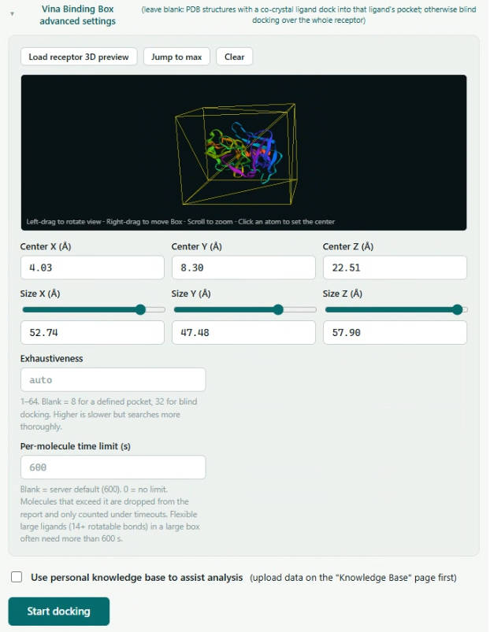
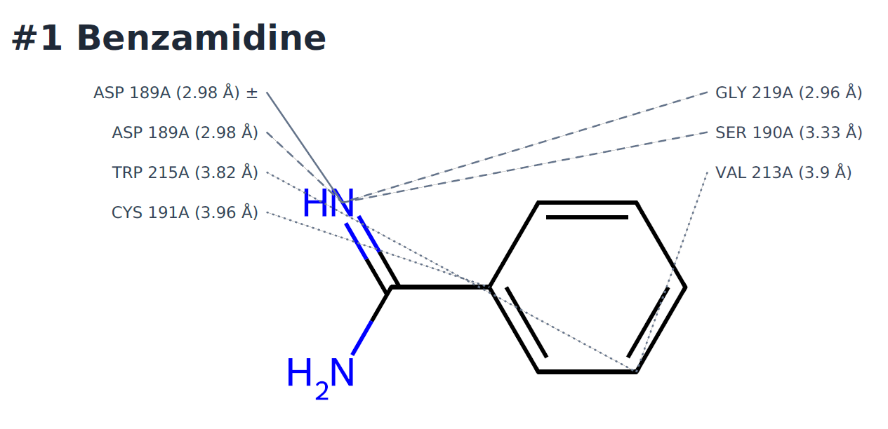

# AI 分子對接分流平台
**AI-assisted Molecular Docking Triage Platform**

> 藥物探索初期的分流工作台：以結合親和力排序，結合 ADMET 與交互作用分析，幫研究者決定**先看哪些分子**。每個數字都可追溯。

> [!NOTE]
> **Source code is private.** 本 repo 為展示頁，平台仍在持續開發。Demo available upon request.

---

## 設計原則：AI 負責解讀，不參與計算

- 對接、ADMET、交互作用分析與排序**全部是確定性計算**，不經過 LLM
- LLM 只在使用者主動提問時解讀結果，回答旁標示資料來源；模型建議了未經查證的化合物時，畫面會顯示警示
- 預設使用**本地模型**，資料不離開部署環境
- 報告記錄方法學參數、引擎版本與隨機種子，**可重現、可稽核**

## 適用與不適用

| ✅ 適用 | ❌ 不適用 |
|---|---|
| 在已知或假設的結合口袋上預測結合姿態與交互作用 | 從大批化合物中可靠地挑出有效分子（見 VP-2） |
| 以親和力、ADMET、交互作用多指標分流，決定檢視順序 | 取代實驗驗證或藥化專家判斷 |
| 產出可重現、可稽核的報告 | 以 AlphaFold 預測結構作為姿態依據（見 VP-3） |

---

## 驗證：先寫死判讀標準，再跑數據

所有驗證都使用**公開基準資料集**，判讀標準在跑數據之前就先定好並版控，結果不好也照實揭露。

| 編號 | 驗證什麼 | 結果 |
|---|---|---|
| **VP-1** 姿態準確度 | Redocking，RMSD < 2 Å 為成功 | Astex Diverse Set **64.7%**、PoseBusters **51.4%**，與 PoseBusters 論文中 AutoDock Vina（57.6% / 52.3%）及商用軟體 GOLD（67.1% / 51.2%）同一水準。CI 每次 push 重跑把關 |
| **VP-2** 虛擬篩選富集 | DEKOIS 2.0：24 個標靶、29,760 個分子 | AUROC 平均 **0.62**，與文獻一致；但前段富集不優於「只看分子大小」的對照組。**依事前標準，不宣稱虛擬篩選能力** |
| **VP-3** AlphaFold 結構 | PoseBusters 396 組，同一配體分別對接進 AlphaFold 模型與晶體結構 | AlphaFold **11.4%** vs 晶體 52.3% → 產品中 AlphaFold 只作參考並強制警示 |
| **VP-5** 口袋預測 | 口袋預測工具 vs 盲對接 | 未通過事前門檻 → **不接入產品** |

另有雙引擎一致性與交叉對接情境的驗證，細節暫不公開。

---

## 核心功能

- **批次對接**：手動輸入、CSV 上傳，或用 2D 結構編輯器手繪分子
- **3D 視覺化**：受體與配體 3D 檢視，滑鼠拖曳設定 binding box；每個分子可切換多個結合模式
- **自訂受體上傳**：支援未發表的私有結構，適合 NDA 下的客戶標靶
- **結果可信度檢查卡**：結構品質、口袋附近缺失殘基、共晶配體再對接陽性對照等，逐項自動檢查
- **ADMET 經驗規則**：Lipinski Ro5、QED、hERG、GI 吸收、合成難易度等，明確標示為經驗規則而非預測模型
- **交互作用分析**：氫鍵、疏水接觸、鹽橋，報告附 2D 交互作用圖
- **問 AI**：針對這批結果提問，可查詢 PubMed、個人知識庫與專利資料，支援多輪對話
- **專利查詢**：EPO 進階關鍵字查詢、PubChem CID 反查、化學結構比對，定位為早期新穎性線索
- **正式報告**：PDF 報告經「草稿 → 審閱 → 定稿」流程，保留版本紀錄；可匯出 Excel、CSV、PDBQT

## AI 治理：把 LLM 當成需要管理的系統

| 要素 | 做法 |
|---|---|
| 規則 | 版控的規則文件，明列禁止行為 |
| 工具邊界 | 每個工具寫明何時可用、何時不可用；唯讀情境直接移除高風險工具 |
| 防護 | 逾時保護、錯誤訊息遮蔽、多租戶資料庫層隔離 |
| 事後驗證 | 檢查回答中的數字與化合物是否真的有來源，不通過就退回重寫 |
| 評測 | 以真實 API 執行的行為評測，鎖住已修正的錯誤 |
| 可觀測性 | 每次呼叫記錄 token 用量與成本，並追蹤生產環境錯誤 |

## 為實際部署而設計

- **地端 Docker 部署**，資料留在客戶網路內
- **多租戶隔離**：資料庫層 Row-Level Security 加上應用層過濾，雙重防護，並有實測驗證
- **稽核日誌**、租戶自帶 API 金鑰（加密儲存）
- **服務重啟自動續跑**未完成的任務
- **CI 自動測試**，涵蓋租戶隔離、驗證流程與報告產生

## 授權與資料合規

- 程式直接使用的套件**僅限 BSD、MIT、Apache 2.0**，排除 GPL / AGPL / LGPL，可商業授權
- 為此主動替換了多個元件，例如 OpenBabel、Redis 7.4、MinIO
- 逐一審查外部資料庫（PDB、AlphaFold DB、PubChem、EPO 等）的授權與引用要求
- 逐一審查 LLM 服務的資料使用條款，**會被拿去訓練的免費方案不用於客戶資料**

---

## 截圖

**Binding box 設定**：在 3D 畫面中拖曳設定對接範圍

**交互作用分析**：Benzamidine 與 trypsin 的結合模式，包含與 ASP 189A 的鹽橋

## 技術概覽

React · FastAPI · PostgreSQL (pgvector) · Prefect · RDKit · AutoDock Vina · LangChain · Docker

---

Built by [Tzu-Yu Huang](https://github.com/Tzuyuu0716) · 相關作品：[Medi-Agent MCP](https://github.com/Tzuyuu0716/medi-agent-mcp)（碩士論文，RAG + MCP 混合式醫療對話系統）
